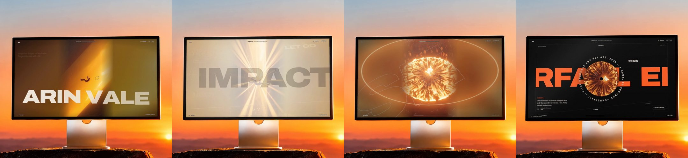

# Freefall

A single-page portfolio for an independent designer, told as one fall. Scrolling drives everything: two films play frame by frame under your scroll, type flies past in 3D, and the story ends at a door you walk through to get in touch.



Watch the full walkthrough: [showcase/freefall-showcase.mp4](showcase/freefall-showcase.mp4) (111 s, 1080×1920, with sound).

## The story, in scroll order

1. **Loader.** A thin gold line fills while the first frames load, then you enter with or without sound.
2. **The leap.** A figure falls through a shaft of light. Words, short lines and buttons rise past him in 3D, tilt with the mouse, and stretch with scroll speed. An altitude readout counts down to zero.
3. **Impact.** At the hard cut the screen flashes white, shakes once and booms.
4. **The noise.** He lands in a crowd surrounded by grey voices ("make the logo bigger"). A ring of fire blows them away.
5. **Rise.** R-I-S-E assembles out of the depth as he stands up.
6. **Index.** The film shrinks into one tile among floating project covers. Click a cover to jump to its case.
7. **Selected work.** Four case screens stack and recede, each with a sliding title, a spinning disc and circular type.
8. **About and services.** A manifesto that lights up word by word, a client marquee that follows your scroll, and service rows with a cursor-following preview.
9. **The portal.** A man walks out of a burning doorway while arches fly past, then the closing call to action.
10. **Contact.** Email, links, a live Lisbon clock, and "Fall again", which rewinds the whole story.

## Run it

Serve the folder with any static server and open it in a browser:

```bash
python -m http.server 8000
```

Then open http://localhost:8000. Opening `index.html` straight from disk also works in most browsers, but a server is more reliable. Fonts (Google Fonts) and smooth scrolling ([Lenis](https://github.com/darkroomengineering/lenis)) load from CDNs, so you need a connection.

## Project layout

```
index.html            all page markup and copy
css/style.css         styles; colours and type are tokens at the top
js/main.js            the scroll engine: frame scrubbing, 3D type, every section
assets/fall/          465 WebP frames of the falling film (30 fps, 720×1280)
assets/portal/        239 WebP frames of the portal film (24 fps, 1600×900)
showcase/             the showcase video and the scripts that make it
```

## Making it yours

The name **Arin Vale**, the email, the clients and the four projects are placeholders.

- **Name, email, projects, services:** `index.html`.
- **Words that fly past during the story:** `WORLD`, `LINES` and `CTAS` near the top of `js/main.js`.
- **Story timing** (which scroll position shows which frame, where the flash and shockwave land): `FRAME_KEYS`, `CUT` and `SHOCK` in `js/main.js`.
- **Colours and fonts:** the `:root` block at the top of `css/style.css`.

From the browser console, `freefall.jump('work')` scrolls to a section (`top`, `work`, `about`, `services`, `portal`, `contact`, or `story:0.5` for a point in the story).

## Rebuilding the showcase video

`showcase/record.mjs` drives headless Chrome through the whole site on a virtual clock, so every animation is captured frame-perfect. `showcase/composite.py` then places that recording on the monitor photo, adds the glass and light spill, and generates the soundtrack from the scroll.

You need Node 22 or newer, Google Chrome, ffmpeg, and Python with Pillow, NumPy and SciPy. Run both from the repository root:

```bash
node showcase/record.mjs
```

```bash
python -I showcase/composite.py
```

Recording takes about 10 minutes and compositing about 15. They produce `showcase/freefall-showcase.mp4` and a flat 1650×900 copy, `showcase/freefall-screen.mp4`. The flat copy is not committed because it is larger than GitHub's 100 MB limit. If Chrome is not in its default location, set the `CHROME` environment variable to its path. The walkthrough's scroll and cursor path is scripted in `record.mjs`, so adjust it there if you change the page layout.
